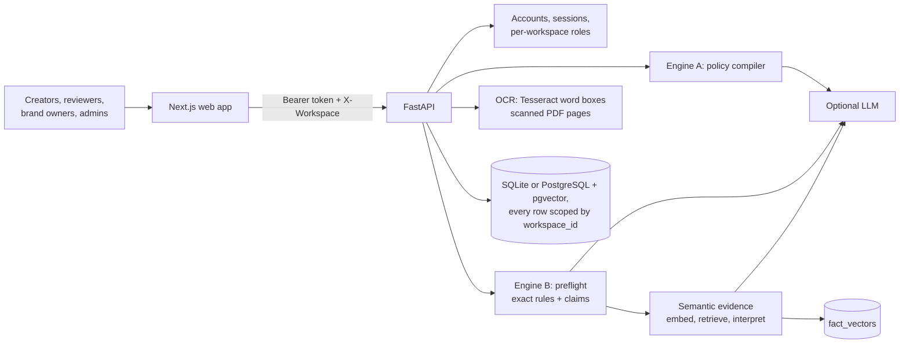

<p align="center"><strong>Pre-publication brand governance: AI suggests, humans decide</strong></p>

# BrandProof

BrandProof checks marketing content before it goes live. It turns written brand guidelines into rules it can check, keeps a ledger of approved product facts, and reviews copy, Word files, PDFs (including scans) and images. Every finding points to the exact phrase or image region, the rule or fact it breaks, the source document, a reason and a suggested fix. A person accepts, edits or overrides each one before anything can be approved.

> Scope: a working prototype using two fictional brands (Lumora / Aura Earbuds and Verdant Oat Co.). Results come from seeded guidelines and facts, not measured customer data.

**Live demo:** https://brand-proof-three.vercel.app · **API docs:** https://brandproof-api-h2pc.onrender.com/docs · **Round 3 submission:** [SUBMISSION.md](SUBMISSION.md) and `BrandProof_Round3.pdf`

## What's new in Round 3

| Improvement promised in Round 2 | What shipped |
| --- | --- |
| **Semantic evidence** — match paraphrased claims like “lasts all weekend” to the right fact | Every fact and claim-like sentence is embedded; the nearest fact is retrieved from a vector index and the paraphrase is *interpreted* (“all weekend” ≈ 48 h) so it can be compared with the fact. Findings show a “Why this fact?” trace with similarity scores. Optional Gemini embeddings run alongside the offline embedder. |
| **OCR for creatives** — read text in banners and scanned PDFs, check it with the same rules, mark the region | Tesseract reads each word with its bounding box. Image text and scanned PDF pages go through every text check, and each finding is drawn as a box on the creative. Gemini vision is a fallback; if neither is available, the finding list says so. Corrected creatives can be uploaded as the next revision. |
| **Accounts + workspaces** — email login, real users in roles, isolated per-brand workspaces with their own audit logs | Email and password accounts (PBKDF2, hashed session tokens, login throttling), roles set per workspace (one person can hold several), invitations, last-admin protection, and full data isolation: rules, facts, submissions, images and the audit log are scoped to the workspace. An agency user can switch between brands. |
| UI/UX | Complete redesign: sign-in with one-click demo accounts, sidebar and workspace switcher, a role-aware home with a setup checklist, review queue, drag-and-drop upload, a review screen with proof marks and image regions, decision progress, keyboard navigation (j / k), toasts, a team page, an activity feed, a “Test a claim” tool, and a mobile layout. |

## Quick start

**Windows, one click:** double-click `start.bat`, then pick a demo account on the sign-in page. Run `reset.bat` for fresh demo data (do this once after upgrading from Round 2).
For OCR on Windows: `winget install --id UB-Mannheim.TesseractOCR` (BrandProof finds it automatically).

**Manual**

```bash
# Backend (Python 3.10+). For OCR also install tesseract-ocr (apt / brew / winget).
cd backend
python -m venv .venv && source .venv/bin/activate     # Windows: .venv\Scripts\activate
pip install -r requirements.txt
uvicorn app.main:app --reload --port 8000             # seeds demo data on first start

# Frontend (Node 18.18+)
cd frontend
npm install
npm run dev                                           # http://localhost:3000
```

Demo accounts (password `demo-pass-2026`, or use the buttons on the sign-in page). Use these to sign in to the Figma plugin and the API too:

| Account | Lumora | Verdant Oat Co. |
| --- | --- | --- |
| asha@lumora.demo | Admin | — |
| ravi@lumora.demo | Brand owner | Admin + brand owner |
| meera@agency.demo | Creator | Creator (agency on two brands) |
| kabir@lumora.demo | Reviewer | — |

## Demo walkthrough (about 5 minutes)

1. **Sign in as Meera (creator).** The home page lists her drafts in review. The workspace switcher shows both brands she works on.
2. **Weekend campaign** (review queue). None of these claims contain a number, so alias matching misses them. Semantic matching catches them all: “last all weekend” is **contradicted** (read as about 48 hours against the approved *up to 24 hours*), “swimming” is **contradicted** by the IPX4 rating, “silence the world” overstates *up to 35 dB*, and “lifetime” warranty is **conflicting** because two sources disagree. Open **Why this fact?** to see the retrieved facts and scores.
3. **Festive sale banner.** The claims are part of the image itself. OCR reads them, and red boxes mark “Lasts all weekend” and “Waterproof” on the banner, alongside the off-palette colour, size and missing alt text.
4. **Store flyer (scanned PDF).** A scan with no text layer is checked the same way, with boxes on the page image.
5. **Accept fixes**, then use **Apply fixes and re-check** (for text) or **Upload corrected file** (for creatives). Each creates a new revision and checks it again. Overrides carry over.
6. **Sign out, sign in as Kabir (reviewer).** **Approve** stays disabled until every high or medium finding has a decision. Override one with a reason, approve, and check the **Decision trail** and **Activity log**.
7. **Sign in as Ravi** and switch to **Verdant Oat Co.**: different rules, facts, content and log. Nothing from Lumora is visible.
8. **Brand rules & facts → Test a claim**: type any sentence to see which fact it retrieves and how it would be judged. Add an example paraphrase to a fact and test again.
9. **Create an account** with your own email: you get an empty workspace and a setup checklist on the home page.

## System architecture



| Component | Location | Responsibility |
| --- | --- | --- |
| Web app | [frontend/app](frontend/app/) | Sign-in, home, check content, review queue, review screen, rules & facts, team, activity |
| API | [backend/app/main.py](backend/app/main.py), [routes/](backend/app/routes/), [core.py](backend/app/core.py) | App assembly; one router per area (auth, workspaces, rules, facts, submissions, governance); shared identity and scoping |
| Background checks | [backend/app/jobs.py](backend/app/jobs.py) | Durable job state on the submission row, worker thread, retries with backoff, crash recovery |
| Rate limiting | [backend/app/ratelimit.py](backend/app/ratelimit.py) | Per-client token buckets, 429 + Retry-After |
| Accounts | [backend/app/auth.py](backend/app/auth.py) | Password hashing, session tokens, throttling, roles |
| Engine A | [backend/app/compiler.py](backend/app/compiler.py) | Guideline sentence → typed rule, ambiguity and conflict detection |
| Engine B | [backend/app/preflight.py](backend/app/preflight.py) | Claim, term, tone, accessibility and visual checks |
| Semantic evidence | [backend/app/semantic.py](backend/app/semantic.py) | Embedding, retrieval, paraphrase interpretation, match trace |
| OCR | [backend/app/ocr.py](backend/app/ocr.py) | Word boxes from images and scanned pages; finding → region mapping |
| Storage | [backend/app/db.py](backend/app/db.py) | Schema, in-place migration from Round 2 |

## Semantic evidence: how it works

1. **Embed.** Each fact is embedded from its label, aliases, value, approved wording, the phrases it rules out, and *example paraphrases* a brand owner can add. Claim-like sentences in the content are embedded the same way.
2. **Retrieve.** The closest fact is picked by cosine similarity. The offline embedder (`local-concept-v1`: word and character n-grams plus a small consumer-product concept lexicon) always runs. With `LLM_PROVIDER=gemini`, `gemini-embedding-001` vectors are added and cached in `fact_vectors`.
3. **Interpret.** Vague wording is turned into a comparable value for the fact's unit (all day ≈ 16 h, all weekend ≈ 48 h, a week ≈ 168 h, “never needs charging” / “complete silence” / “lifetime” = unlimited). For wording-only facts, the sentence is compared with the approved and ruled-out wording.
4. **Decide.** The result goes through the same comparator, validity and conflict logic as numeric claims. If the wording can't be interpreted, the finding is `unverified`, with the nearest fact cited, and an optional LLM verifier may upgrade it to `contradicted`. A claim already checked by an exact rule isn't reported twice.

**Evaluation** (`python -m eval.semantic_eval --csv eval/kaggle_benchmark.csv`, offline embedder, no LLM):

| Set | Method | Precision | Recall | F1 | Fact retrieval |
| --- | --- | --- | --- | --- | --- |
| Team-written paraphrases (40) | Exact rules only | 1.00 | 0.33 | 0.50 | 0.31 |
| | Exact rules + semantic | 0.95 | 0.90 | 0.93 | 0.76 |
| Real Kaggle text (325) | Exact rules only | 0.96 | 0.88 | 0.92 | 0.50 |
| | Exact rules + semantic | 0.89 | 0.89 | 0.89 | 0.65 |

*Precision / recall* = flagging sentences that, placed in Aura Earbuds copy, would contradict or conflict with the ledger.

- **Kaggle set:** 325 sentences sampled from public Kaggle data (Amazon India and Flipkart product listings and reviews, Amazon phone reviews): battery, water, noise and warranty mentions plus random negatives, many of them hard (“blows it out of the water”, 110 dB car horns, sweaters). Hand-labelled by the team with one written rule: a sentence is flagged if, as Aura Earbuds copy, it exceeds the approved spec, implies more than IPX4, or states any warranty term (the ledger's two warranty sources disagree). File: [backend/eval/kaggle_benchmark.csv](backend/eval/kaggle_benchmark.csv).
- **What it shows:** real copy mostly states figures outright (“2 year warranty”, “35-hour playtime”), and the exact rules catch those. Semantic matching adds paraphrase coverage (the 40-case set) and better fact retrieval, at the cost of a few false alarms on idioms like “total silence” in a room.
- **Changes made after seeing these results:** unit conversion (days, weeks and months compared against years), number words (“one year”), and negation (“didn't go swimming”, “need a waterproof case”). These improved the exact-rules baseline too. Treat the set as a development set; a held-out set is the next step.

## OCR: how it works

- **Images:** Tesseract runs in two page-segmentation modes (layout and sparse text) and keeps the better result. Small images are upscaled first. Words below 55% confidence are dropped. Each word keeps its box and its character offsets in the extracted text.
- **PDFs:** pages with a text layer use it directly. Pages without one (scans) are rendered at 150 dpi and OCR'd, up to 10 pages. Guideline PDFs that are scans also work.
- **Regions:** after all text checks run, each finding's character span is mapped back to the union of the word boxes it covers, then drawn on the right page.
- **Fallbacks:** Gemini vision provides text without boxes. With no engine, visual checks still run and a low-severity finding says that text in the image wasn't read.

## Figma plugin

[figma-plugin/](figma-plugin/) checks the selected frames or text layers from inside Figma: findings are mapped back to each layer, **Show layer** zooms to it, **Apply fix** edits the text in place (keeping its styling), and the selection can be sent to the review queue with a frame image. Install it from the Figma desktop app: **Plugins → Development → Import plugin from manifest**. See [figma-plugin/README.md](figma-plugin/README.md). API: `POST /api/integrations/figma/check`.

## Accounts, roles and workspaces

| Action | Creator | Reviewer | Brand owner | Admin |
| --- | :---: | :---: | :---: | :---: |
| Upload guidelines, edit or switch on rules, manage facts | | | ✓ | ✓ |
| Submit content | ✓ | | ✓ | ✓ |
| Accept or write a fix, apply fixes as a revision | ✓ | ✓ | ✓ | |
| Override a finding (reason required) | | ✓ | ✓ | |
| Approve, reject, request changes | | ✓ | ✓ | |
| Add members, change roles, rename workspace | | | | ✓ |

- Registering creates your own workspace, where you hold every role. Pending invitations to your email are accepted automatically.
- Admins add existing users directly or leave an invitation; either way the person gets an email (via Resend), and an invitee joins by signing up with that address.
- **Forgot password:** sends a single-use link valid for 1 hour, signs the user out on other devices once used, and always gives the same answer whether or not the email has an account. Demo accounts can't be reset.
- **Email setup:** Gmail API (`GMAIL_CLIENT_ID`, `GMAIL_CLIENT_SECRET`, `GMAIL_REFRESH_TOKEN`), Resend (`RESEND_API_KEY`) or, on a local machine, Gmail SMTP (`GMAIL_ADDRESS`, `GMAIL_APP_PASSWORD`); plus `MAIL_FROM` and `APP_URL`. Render's free plan blocks SMTP ports, so use the Gmail API or Resend there. With nothing set, emails are written to the server log.
- Every query is filtered by the workspace from the `X-Workspace` header, after checking membership. Requests for another workspace's records return 404, and images are served only through the authenticated API.
- Demo login (`BRANDPROOF_DEMO=1`) issues real sessions for the seeded demo users. Set it to `0` in production.

## Background checks and rate limiting

- **Background checks:** an upload is stored and returns at once with `check_status: queued`; a worker thread does extraction, OCR and all checks, and the review page shows "Checking…" and updates itself. The submission row is the durable job record, so jobs left unfinished by a restart are picked up again on start. Jobs are idempotent (findings are replaced, never appended), failures retry with exponential backoff (2 s, 4 s, 8 s), and after 3 attempts the error is shown with a **Check again** button. Decisions and approval are blocked until the check is done. `BRANDPROOF_SYNC_CHECKS=1` runs checks inline.
- **Rate limiting:** per client (sign-in token, else IP from `X-Forwarded-For`), per minute: sign-in 10, uploads and re-checks 20, other writes 90, reads 300. Over the limit returns `429` with `Retry-After`. Failed logins are also capped per email (6 per 5 minutes). Uploads over `MAX_UPLOAD_MB` (15) return `413`.
- **Scope:** both are in-process, which suits one Render instance. For several instances, move the queue to Redis/RQ or a Postgres `SKIP LOCKED` poller and the counters to Redis; the job function stays the same.

## Finding statuses

| Status | Meaning |
| --- | --- |
| Supported | Matches an approved, current fact |
| Contradicted | Conflicts with an approved fact (also for paraphrases that overstate it) |
| Expired | The matching fact is outside its validity dates |
| Conflicting | Two approved sources disagree |
| Unverified | No fact covers the claim, or the wording can't be compared. Not marked wrong. |
| Rule broken | A term, tone, accessibility, disclaimer or visual rule is broken |

The engine tag shows who found it: **Exact rule** (deterministic), **Matched by meaning** (semantic) or **AI**.

## Configuration and tests

`backend/.env` (copy from `.env.example`):

| Variable | Default | Purpose |
| --- | --- | --- |
| `LLM_PROVIDER` | empty | `gemini`, `openai` or `anthropic`; empty = deterministic + local semantic |
| `GEMINI_API_KEY` / `OPENAI_API_KEY` / `ANTHROPIC_API_KEY` | empty | Key for the chosen provider |
| `LLM_MODEL` | provider default | Model override (e.g. `gemini-3.5-flash-lite`) |
| `GROQ_API_KEY` | empty | Optional fallback: used when the main provider is busy, rate-limited or failing |
| `GROQ_MODEL` | `openai/gpt-oss-120b` | Groq model override |
| `SEMANTIC_REMOTE` | `1` | Use Gemini embeddings when the provider is Gemini |
| `SEMANTIC_T_LOCAL` / `SEMANTIC_T_REMOTE` | `0.20` / `0.78` | Retrieval thresholds |
| `TESSERACT_CMD` | auto | Path to tesseract if it isn't on PATH |
| `OCR_DISABLED` | `0` | Turn OCR off |
| `BRANDPROOF_DEMO` | `1` | Show demo accounts on the sign-in page |
| `BRANDPROOF_AUTOSEED` | `1` | Seed demo data when there are no users |
| `DATABASE_URL` | empty | `postgresql://…` switches to PostgreSQL + pgvector; empty = SQLite |
| `BRANDPROOF_DB` | `backend/brandproof.db` | SQLite path (when `DATABASE_URL` is empty) |
| `CORS_ORIGINS` | `*` | Allowed web origins (the Figma plugin origin is always allowed) |
| `RATE_LIMIT` / `RATE_LIMIT_SCALE` | `1` / `1` | Turn rate limiting off, or scale all limits |
| `MAX_UPLOAD_MB` | `15` | Largest accepted upload |
| `GMAIL_CLIENT_ID` / `GMAIL_CLIENT_SECRET` / `GMAIL_REFRESH_TOKEN` | empty | Send email through the Gmail API (HTTPS; works on Render free) |
| `RESEND_API_KEY` | empty | Send email through Resend instead |
| `GMAIL_ADDRESS` / `GMAIL_APP_PASSWORD` | empty | Gmail SMTP, local or paid hosting only |
| `MAIL_FROM` | `BrandProof <onboarding@resend.dev>` | Sender (use an address on a domain verified in Resend) |
| `APP_URL` | `http://localhost:3000` | Web app address used in email links |
| `BRANDPROOF_SYNC_CHECKS` | `0` | Run checks inline instead of in the background worker |

```bash
cd backend
pytest -q                      # 27 API tests (OCR tests skip if tesseract is missing)
python -m eval.semantic_eval   # semantic vs alias-only comparison
python -m app.seed --reset     # fresh demo data (stop the API first)
```

Tests cover authentication, registration and isolation, the agency case across two workspaces, invitations, last-admin protection, Round 2 evidence statuses, the ambiguity gate, RBAC, the approval gate, revise and re-run, semantic matching (contradicted, supported, no false positive, no double reporting), OCR on banners, scanned PDFs and uploads, revision upload, the no-OCR notice, and the AI path with a mocked model.

## Deploy

**Backend on Render (Docker, includes Tesseract):** render.com → **New → Blueprint** → this repo. [render.yaml](render.yaml) builds [backend/Dockerfile](backend/Dockerfile). Enter `GEMINI_API_KEY` when asked, then check `/api/health` shows `"ocr": "tesseract"`.

**Frontend on Vercel:** root directory `frontend`, environment variable `NEXT_PUBLIC_API_URL=https://<backend>.onrender.com`.

**Database (optional, recommended):** create a free Postgres on Neon or Supabase (both include pgvector), copy the connection string (with `?sslmode=require`) into Render's `DATABASE_URL`, and redeploy. Tables and the `vector` extension are created on start, demo data seeds once, and accounts, content and images (stored in the `blobs` table) survive restarts. `/api/health` then shows `"db": "postgresql + pgvector"`. Without it the service uses SQLite, which Render's free disk wipes on restart.

**AI resilience:** if a model is retired, busy or rate-limited, the next model is tried, then Groq (if `GROQ_API_KEY` is set); if all are unavailable, checks run on the deterministic engine and semantic layer for two minutes instead of waiting. Demo data is seeded without the AI, so restarts don't spend API quota.

**Render environment (backend):** `LLM_PROVIDER=gemini`, `GEMINI_API_KEY`, `LLM_MODEL`, optional `GROQ_API_KEY`, `CORS_ORIGINS=https://<frontend>.vercel.app`, `BRANDPROOF_AUTOSEED=1`, and for email `GMAIL_CLIENT_ID`, `GMAIL_CLIENT_SECRET`, `GMAIL_REFRESH_TOKEN`, `MAIL_FROM`, `APP_URL`. If deploys show as *Manual*, turn on Auto-Deploy or use **Manual Deploy → Deploy latest commit** after each push. **Vercel:** `NEXT_PUBLIC_API_URL`, then redeploy (it is baked in at build time).

Render's free plan sleeps after about 15 minutes idle; the first request takes 30–60 s.

## Status and limitations

| | |
| --- | --- |
| **Implemented** | Everything above: policy compiler (14 rule types) with ambiguity gate, evidence ledger, semantic evidence retrieval, OCR with region marking, accounts and isolated workspaces, revisions, approval gate, insights, activity log, optional AI layer with fallbacks |
| **Simplified** | pgvector ranks Gemini embeddings in SQL; the offline embedder's sparse vectors are compared in Python (fine for ledgers of hundreds of facts). On SQLite, Gemini vectors are compared in Python too. The Figma plugin is a development plugin, not yet published to the Figma Community. |
| **Heuristic** | The offline embedder relies on a consumer-electronics concept lexicon plus each fact's examples; other industries need examples or Gemini embeddings. Image contrast compares the two dominant colours, not every text element. OCR quality depends on the creative (stylised fonts may be missed). |
| **Not built** | Google Docs / Canva add-ons, CMS / DAM integrations, SSO, video and audio, multilingual checks |

## Repository map

| Path | Contents |
| --- | --- |
| [backend/app](backend/app/) | API, auth, compiler, preflight, semantic, OCR, LLM layer, storage, seed |
| [backend/tests](backend/tests/) | API tests |
| [backend/eval](backend/eval/) | Semantic evaluation script |
| [backend/Dockerfile](backend/Dockerfile) | API image with Tesseract |
| [frontend/app](frontend/app/) | Next.js pages |
| [frontend/components](frontend/components/), [frontend/lib](frontend/lib/) | App shell, session, badges, API client |
| [figma-plugin](figma-plugin/) | Figma plugin (manifest, main thread, UI) |
| [samples](samples/) | Guidelines, launch post, paraphrased campaign; the banner and scanned flyer are generated on first seed |
| `start.bat` / `reset.bat` | Windows launch and demo reset |
