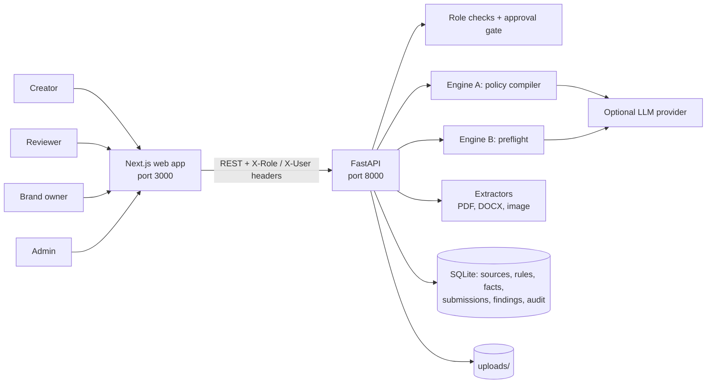

<p align="center">
  <strong>Pre-publication brand governance: AI suggests, humans decide</strong>
</p>

# BrandProof

BrandProof is a pre-publication gate for brand-safe content. It compiles written brand guidelines into typed, source-linked rules, keeps a ledger of approved product facts, and checks drafts (text, PDF, DOCX and images) before they go live.

A draft can sound on-brand and still be wrong. BrandProof ties every finding to the exact text span or image region, the rule or fact it breaks, the source document and line, a reason and a suggested fix. A human accepts, edits or overrides each one before anything can be approved.

> Scope: a single-workspace prototype that uses fictional brand data (Lumora / Aura Earbuds). Findings come from seeded guidelines and facts, not measured customer results. Role switching is a demo convenience, not authentication.

**Live demo:** `<add Vercel URL>` · **API docs:** `<add Render URL>/docs`

## Quick start

**Windows, one click:** double-click `start.bat`. The first run creates the Python environment and installs packages; after that it starts the API (port 8000) and the web app (port 3000) and opens the browser. Run `reset.bat` to get fresh demo data.

**Manual**

```bash
# Backend (Python 3.10+)
cd backend
python -m venv .venv && source .venv/bin/activate     # Windows: .venv\Scripts\activate
pip install -r requirements.txt
uvicorn app.main:app --reload --port 8000             # seeds demo data on first start

# Frontend (Node 18.18+)
cd frontend
npm install
npm run dev                                           # http://localhost:3000
```

If the API runs somewhere other than `http://localhost:8000`, set `NEXT_PUBLIC_API_URL` before building the frontend.

## Demonstration

1. **Overview** (`/`): KPIs, issues by category, and *Unclear guidelines*. The compiler has flagged a vague rule, an untyped rule and a real conflict ("Aura Pro" is both banned and required).
2. **Sources & rules** (`/sources`), as **Admin**: conflicting and vague rules stay `proposed`, and activating an untyped or incomplete rule is refused. The **Evidence ledger** shows battery life `max 24 hours`, an **expired** launch price and two warranty facts that disagree.
3. **Launch post** (or upload `samples/launch_post.txt` in **New preflight**): "72-hour" is **contradicted** (Product Spec v3, p.2 → suggests "up to 24-hour"), "2-year" is **conflicting**, "₹3,999" is **expired**, "#1" is **unverified**, and the GST disclaimer is missing.
4. As **Creator**: accept the fixes, then **Apply fixes → new revision**. The preflight re-runs on the corrected text.
5. As **Reviewer**: **Approve** stays blocked until every high or medium finding is decided. Override one with a reason, approve, then open the **Decision trail** and the **Audit log**.
6. **Festive sale banner**: an image region is highlighted for an off-palette colour (with the nearest brand colour suggested), low resolution and missing alt text.
7. *(Optional)* Paste new guideline text under **Upload guidelines** and watch it compile into rules live.

## Contents

- [What is built](#what-is-built)
- [System architecture](#system-architecture)
- [End-to-end workflow](#end-to-end-workflow)
- [Policy compiler and rule types](#policy-compiler-and-rule-types)
- [Preflight engine and finding statuses](#preflight-engine-and-finding-statuses)
- [Roles, approval gate and audit](#roles-approval-gate-and-audit)
- [AI/LLM integration](#aillm-integration)
- [Outputs and user interface](#outputs-and-user-interface)
- [Installation, configuration and tests](#installation-configuration-and-tests)
- [Deploy (Render + Vercel, free)](#deploy-render--vercel-free)
- [Status and limitations](#status-and-limitations)
- [Repository map](#repository-map)

## What is built

| Area | Actual implementation |
| --- | --- |
| Policy compiler | Prose guidelines (paste, TXT, MD, PDF, DOCX) are split into sentences and compiled into 14 typed rule kinds, each linked to its source document and line. |
| Ambiguity gate | Vague, untyped, incomplete or conflicting rules stay `proposed`. The API refuses to activate a rule until it has a type and every required parameter. |
| Evidence ledger | Approved facts with value, unit, comparator (exact/max/min), aliases, disallowed phrasings, approved phrasing, source, owner, scope and validity dates. |
| Preflight | Checks text, PDF, DOCX and PNG/JPG/WEBP against active rules and facts. Each finding has a span or region, rule, fact, source, reason, suggestion, confidence and engine. |
| Corrections | Accepted fixes create a new revision and re-run the preflight. Reviewer overrides require a reason and carry forward to later revisions. |
| Workflow | Four roles enforced server-side; approval is blocked while any high or medium finding is pending. |
| Governance insights | Repeated issues, rules overridden ≥ 50% of the time (unclear guidelines), rules awaiting validation, missing evidence and override rate. |
| Audit log | Append-only record of uploads, rule changes, preflights, decisions and status changes. |
| AI layer | Optional Gemini / OpenAI / Anthropic provider. Every AI feature has a deterministic fallback. |

## System architecture



| Component | Location | Responsibility |
| --- | --- | --- |
| Web app | [frontend/app](frontend/app/) | Overview, New preflight, Sources & rules, submission review, Audit log. No direct database access. |
| API | [backend/app/main.py](backend/app/main.py) | Routes, role checks, approval gate, revisions, insights, audit writes. |
| Engine A | [backend/app/compiler.py](backend/app/compiler.py) | Sentence → typed rule, ambiguity and conflict detection, required-parameter validation. |
| Engine B | [backend/app/preflight.py](backend/app/preflight.py) | Claim, term, tone, accessibility and visual checks; span overlap resolution. |
| Extractors | [backend/app/extract.py](backend/app/extract.py) | Text from PDF (PyMuPDF) and DOCX (python-docx); image loading (Pillow). |
| LLM layer | [backend/app/llm.py](backend/app/llm.py) | Provider switch, JSON responses, returns `None` on any failure. |
| Storage | [backend/app/db.py](backend/app/db.py), [backend/app/seed.py](backend/app/seed.py) | SQLite schema, helpers and demo seed data. |

| Design rule | Meaning |
| --- | --- |
| Traceable findings | Every finding names its rule or fact, source and location. No unexplained scores. |
| Deterministic core | Exact rules and fact comparisons never depend on an LLM. |
| Missing evidence ≠ wrong | A claim with no matching fact is `unverified`, never `contradicted`. |
| Human final call | The system suggests; creators and reviewers decide, and overrides need a reason. |
| Fail safe | A malformed rule is skipped, and a failed AI call falls back to deterministic checks; neither crashes a preflight. |

## End-to-end workflow

1. A **brand owner or admin** uploads guidelines. The compiler proposes typed rules and flags vague, untyped and conflicting ones.
2. An **admin** fixes types and parameters, then activates rules. Incomplete rules are refused.
3. A **brand owner** maintains the evidence ledger (facts, sources, validity dates).
4. A **creator** submits a draft or file. The preflight runs against active rules and facts.
5. The **creator** accepts or edits suggested fixes; accepted fixes produce a new revision and an automatic re-run.
6. A **reviewer** decides the remaining findings (an override requires a reason) and approves or rejects. Approval is blocked while high or medium findings are pending.
7. Every step lands in the **audit log**, and repeated patterns surface in **governance insights**.

## Policy compiler and rule types

| Rule type | Category | Parameters | What it checks |
| --- | --- | --- | --- |
| `banned_term` | term | `terms` | Words or phrases that must not appear |
| `preferred_term` | term | `use`, `avoid` | Approved term instead of variants (case-sensitive for brand names) |
| `tone_avoid` | tone | `terms` | Hype or off-tone language, with replacements |
| `tone_profile` | tone | `description` | Contextual tone (AI) |
| `max_exclamations` | tone | `max` | Exclamation marks per piece |
| `claim_evidence` | claim | `topics` | Claims on listed topics must match the evidence ledger |
| `disclaimer_required` | claim | `trigger`, `text` | Required disclaimer when a trigger appears |
| `max_sentence_words` | accessibility | `max` | Sentence length |
| `no_all_caps` | accessibility | none | ALL-CAPS words |
| `descriptive_links` | accessibility | none | "Click here" style link text |
| `alt_text_required` | accessibility | none | Images without alt text |
| `visual_palette` | visual | `colors` | Off-palette dominant colours, with the nearest brand colour suggested |
| `visual_min_contrast` | visual | `ratio` | Contrast between dominant colours (heuristic) |
| `visual_min_resolution` | visual | `min_width`, `min_height` | Minimum image width and height |

Sentences the patterns can't type go to the LLM (if configured) and are tagged `ai-typed`; they still need admin validation. Anything left over is `unclassified`.

## Preflight engine and finding statuses

| Status | Meaning |
| --- | --- |
| `supported` | Claim matches an approved, in-date fact |
| `contradicted` | Claim conflicts with an approved fact (for example "72-hour" vs `max 24 hours`) |
| `expired` | The matching fact is outside its validity dates |
| `conflicting` | Two approved sources disagree |
| `unverified` | No fact covers the claim; flagged for evidence, not marked wrong |
| `violation` | A term, tone, accessibility, disclaimer or visual rule is broken |

Each finding carries a severity (high / medium / low), a confidence score and an engine tag (`deterministic` or `ai`). Overlapping matches are resolved, so one span is reported once.

## Roles, approval gate and audit

| Action | Creator | Reviewer | Brand owner | Admin |
| --- | :---: | :---: | :---: | :---: |
| Upload guidelines, edit or activate rules, manage facts | | | ✓ | ✓ |
| Submit content for preflight | ✓ | | ✓ | ✓ |
| Accept or edit a suggested fix | ✓ | ✓ | ✓ | |
| Override a finding (reason required) | | ✓ | ✓ | |
| Apply fixes as a new revision | ✓ | ✓ | ✓ | |
| Approve or reject a submission | | ✓ | ✓ | |

Roles are sent in the `X-Role` header and checked on every write. This is a demo role switch, not authentication.

## AI/LLM integration

Set a provider in `backend/.env` (see [Installation](#installation-configuration-and-tests)). With no key, everything runs on deterministic and heuristic checks. With a key, the AI:

- types guideline sentences the patterns couldn't (tagged `ai-typed`, still needing admin validation)
- checks contextual tone against the tone profile
- extracts extra factual claims, which are only ever marked `unverified`

AI findings carry `engine: ai` and lower confidence. If a call fails or times out, the preflight continues without it, and the key is masked in logs.

## Outputs and user interface

| Page | Path | Contents |
| --- | --- | --- |
| Overview | `/` | KPIs, issues by category and status, unclear guidelines, repeated issues, submissions |
| New preflight | `/preflight` | Paste text or upload TXT, MD, PDF, DOCX or image; channel; alt text |
| Sources & rules | `/sources` | Rules (edit, validate, activate), evidence ledger, guideline upload |
| Submission review | `/submissions/[id]` | Highlighted content, findings by tab, accept / edit / override, revisions, decision trail |
| Audit log | `/audit` | Append-only event history |

The top bar shows the active AI mode and a role switcher.

## Installation, configuration and tests

`backend/.env` (copy from `.env.example`; `start.bat` and the API load it automatically):

| Variable | Default | Purpose |
| --- | --- | --- |
| `LLM_PROVIDER` | empty | `gemini`, `openai` or `anthropic`; empty means deterministic only |
| `GEMINI_API_KEY` / `OPENAI_API_KEY` / `ANTHROPIC_API_KEY` | empty | Key for the chosen provider |
| `LLM_MODEL` | provider default | Model override (for example `gemini-2.5-flash`) |
| `BRANDPROOF_AUTOSEED` | `1` | Seed demo data when the database is empty |
| `BRANDPROOF_DB` | `backend/brandproof.db` | SQLite path |
| `CORS_ORIGINS` | `*` | Allowed web origins (comma-separated) |

Frontend: `NEXT_PUBLIC_API_URL` (default `http://localhost:8000`), read at build time.

```bash
cd backend
pytest -q                       # 10 API tests
python check_ai.py              # confirms the configured LLM key works with one live call
python -m app.seed --reset      # fresh demo data (stop the API first)
```

The tests cover the evidence statuses, the ambiguity gate, RBAC, the approval gate, revise and re-run, the disclaimer insert, image checks, DOCX compile, the LLM path with a mocked model and malformed-rule safety.

## Deploy (Render + Vercel, free)

**1. Backend on Render** (config in [render.yaml](render.yaml))
- render.com → **New → Blueprint** → select this repo → enter `GEMINI_API_KEY` when asked.
- Check `https://<backend>.onrender.com/api/health` returns `"ok": true`.

**2. Frontend on Vercel**
- vercel.com → **Add New → Project** → this repo → **Root Directory:** `frontend`.
- Environment variable `NEXT_PUBLIC_API_URL=https://<backend>.onrender.com` (no trailing slash), then **Deploy**. Redeploy if you change it later.

Render's free tier sleeps after about 15 minutes idle, so the first request can take 30–60 seconds. A free uptime monitor hitting `/api/health` every 10 minutes keeps it awake. The free disk is not persistent: SQLite resets on restart and the demo data re-seeds itself.

## Status and limitations

| Status | Scope |
| --- | --- |
| Implemented | Policy compiler (14 rule types), ambiguity and conflict gate, evidence ledger, preflight on text/PDF/DOCX/images, five claim statuses, suggested fixes with revisions, reasoned overrides, four-role workflow and approval gate, governance insights, audit log, optional AI layer with fallback |
| Heuristic | Image contrast compares the two dominant colours, not each text element (not full WCAG); fact matching uses aliases and units, so heavy paraphrases may come back `unverified` |
| Not built yet | Authentication and per-brand workspaces; OCR for text inside images; embedding-based fact retrieval (pgvector); PostgreSQL and async jobs (Redis/Celery); integrations with design or CMS tools |

Demo simplifications compared with the proposed stack: SQLite instead of PostgreSQL + pgvector, synchronous checks instead of Redis/Celery, alias and unit matching instead of embeddings, and a header-based role switch instead of real auth. The schema ports directly.

## Repository map

| Path | Contents |
| --- | --- |
| [backend/app](backend/app/) | FastAPI API, policy compiler, preflight engine, LLM layer, extractors, database and seed data |
| [backend/tests](backend/tests/) | API tests |
| [backend/check_ai.py](backend/check_ai.py) | One-call check that the LLM key works |
| [frontend/app](frontend/app/) | Next.js pages: overview, preflight, sources, submission review, audit |
| [frontend/components](frontend/components/), [frontend/lib](frontend/lib/) | Shell, badges, API client and role personas |
| [samples](samples/) | Example guidelines, launch post and banner image |
| `start.bat` / `reset.bat` | Windows one-click launch and demo reset |
